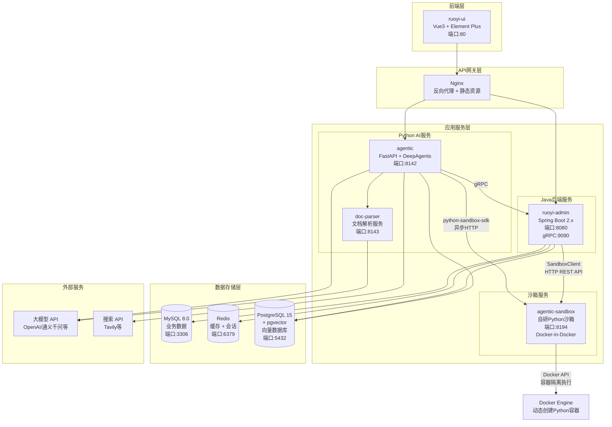
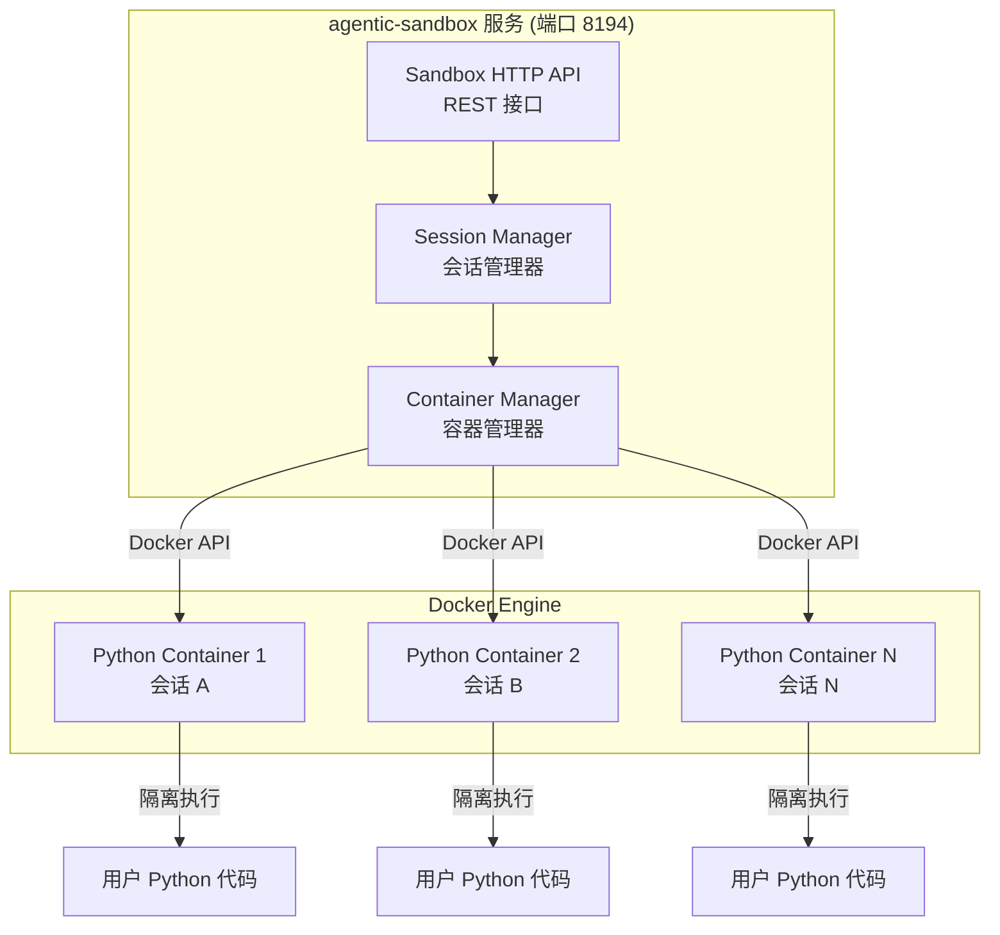
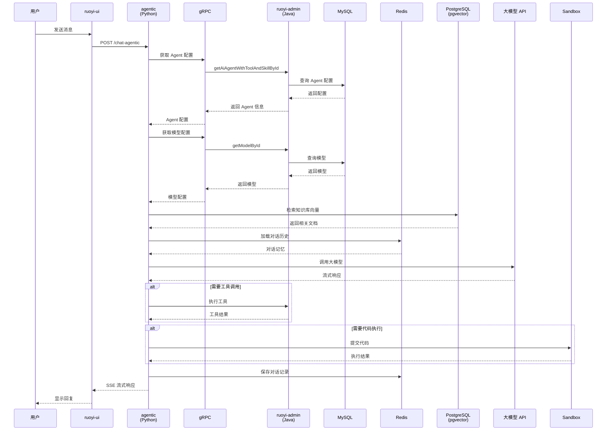
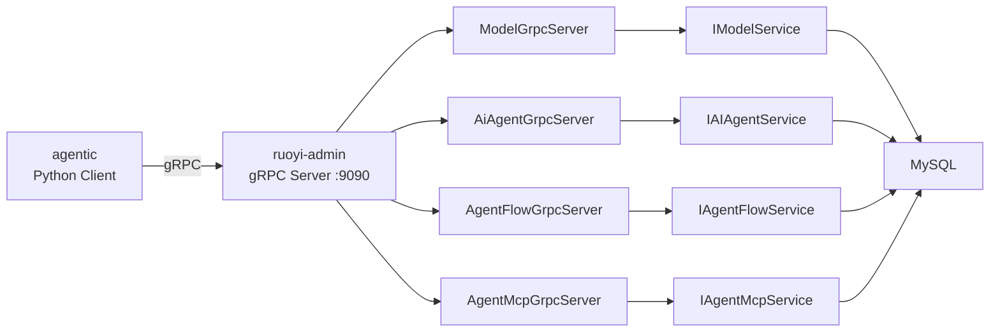
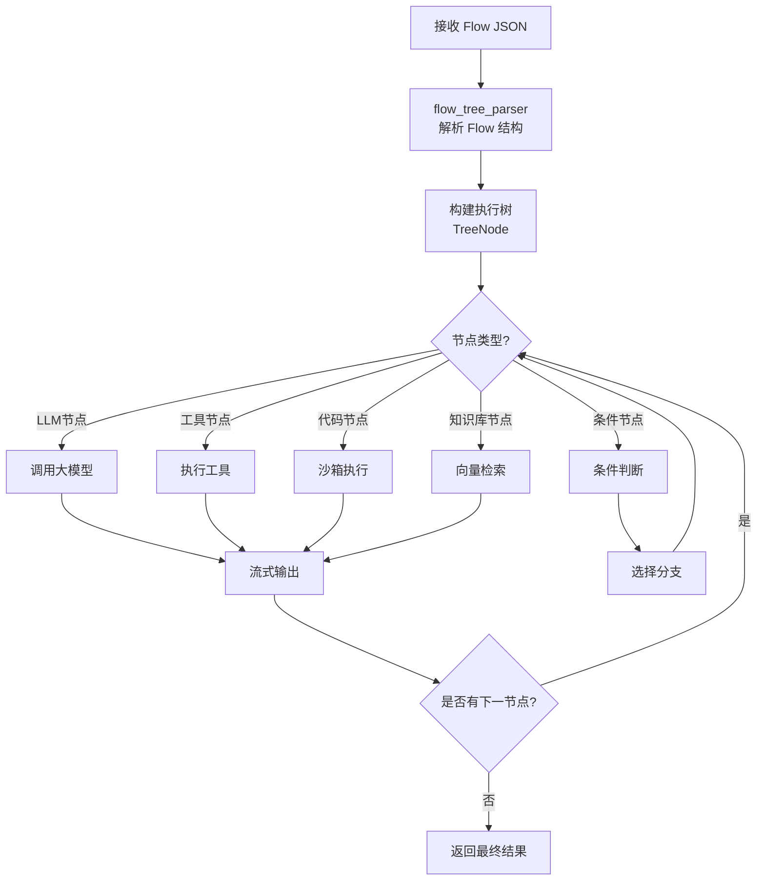
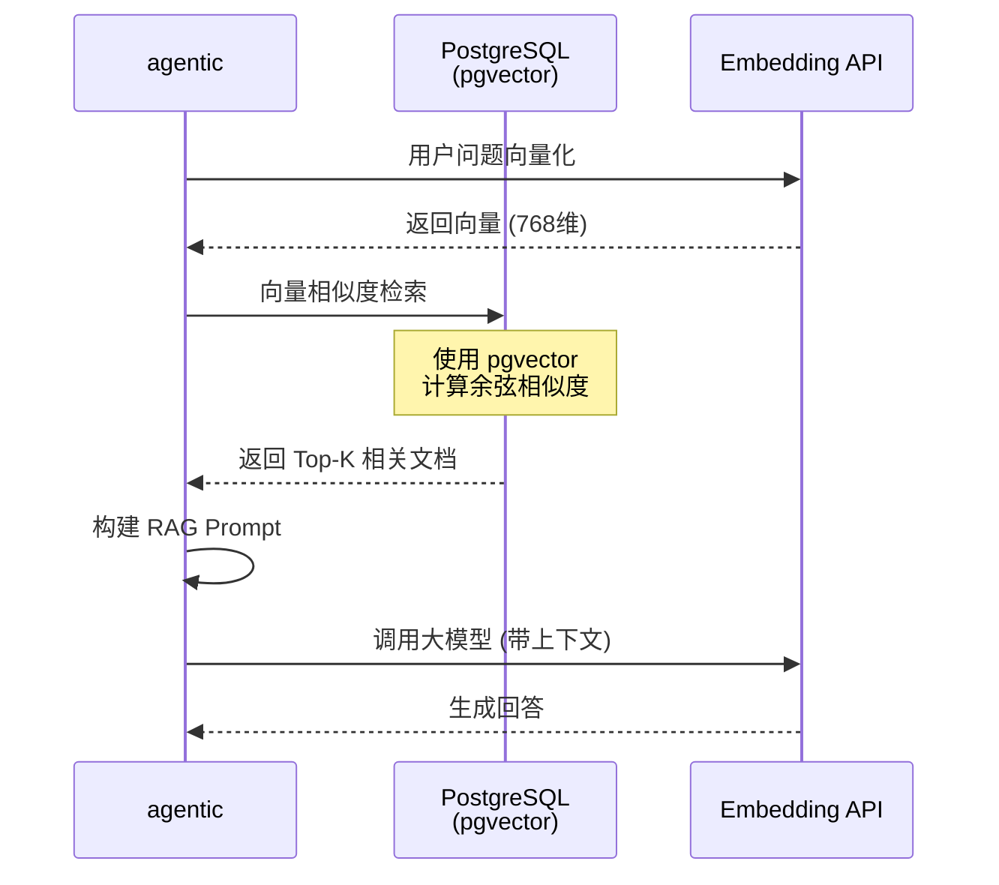
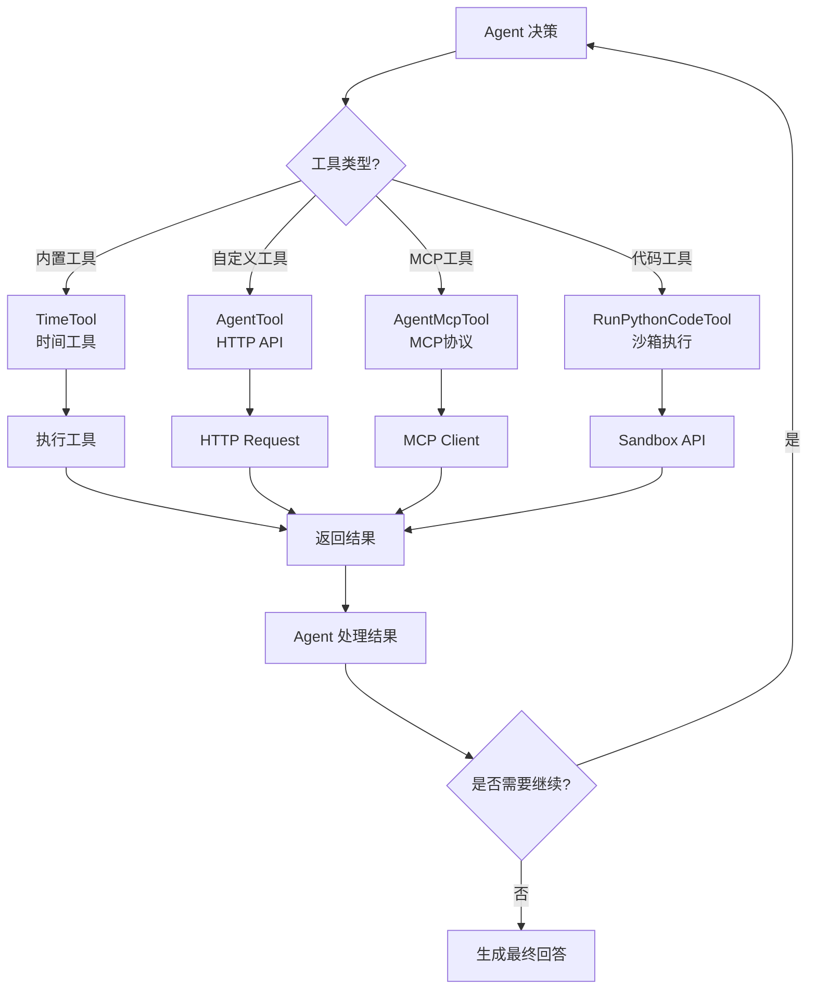
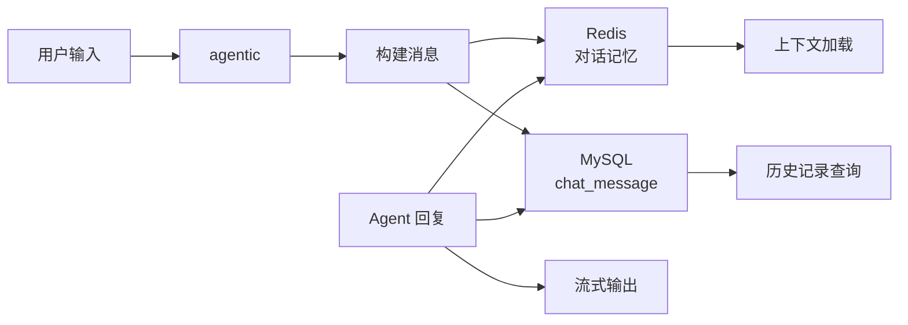
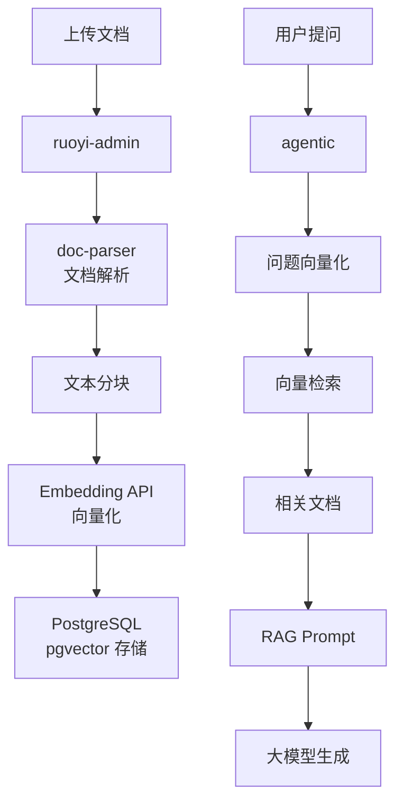
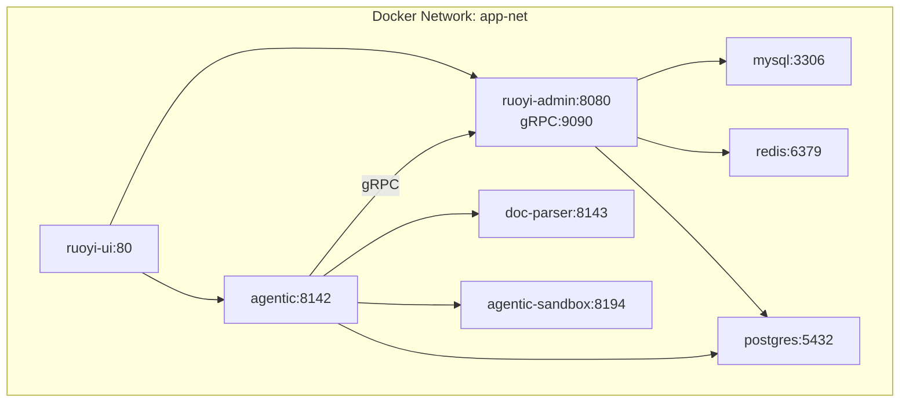

# 若依 LangChain4j 项目架构设计文档

## 1. 系统架构概览

本项目是一个基于若依框架的 AI 智能体应用平台，采用微服务架构，集成了 LangChain4j 和 Python DeepAgents 技术栈。

### 1.1 整体架构图



## 2. 服务组件详解

### 2.1 核心服务

#### 2.1.1 ruoyi-admin (Java 后端服务)

**技术栈**：
- Spring Boot 2.x
- MyBatis + Druid 连接池
- LangChain4j (AI 能力集成)
- gRPC Server (端口 9090)

**核心职责**：
- 用户认证与权限管理
- AI Agent 配置管理
- 模型管理
- 知识库管理
- 工具管理
- MCP 服务管理
- 对话记录存储
- 提供 gRPC 服务供 Python 服务调用

**关键模块**：
```
ruoyi-admin/
├── src/main/java/com/ruoyi/
│   ├── web/controller/          # REST API 控制器
│   ├── ai/
│   │   ├── controller/          # AI 相关 API
│   │   ├── service/             # AI 业务逻辑
│   │   │   └── grpc/server/     # gRPC 服务端实现
│   │   ├── component/
│   │   │   ├── flow/            # Agent Flow 解析器
│   │   │   ├── mcp/             # MCP 协议实现
│   │   │   └── memory/          # 对话记忆管理
│   │   ├── domain/              # 领域模型
│   │   └── mapper/              # MyBatis Mapper
│   └── framework/               # 框架配置
```

**gRPC 服务接口**：
- `ModelGrpcServer`: 模型信息查询
- `AiAgentGrpcServer`: AI Agent 信息查询
- `AgentFlowGrpcServer`: Agent Flow 配置查询
- `AgentMcpGrpcServer`: MCP 服务配置查询

#### 2.1.2 agentic (Python AI Agent 服务)

**技术栈**：
- FastAPI
- LangChain / DeepAgents
- gRPC Client
- SQLAlchemy (异步)

**核心职责**：
- Agent Flow 执行引擎
- 多 Agent 协作编排
- 工具调用管理
- 联网搜索集成
- 代码执行沙箱集成
- 流式响应输出 (SSE)

**关键模块**：
```
agentic/
├── main.py                      # FastAPI 应用入口
├── grpc_client.py               # gRPC 客户端
├── service/
│   ├── auth.py                  # Token 认证
│   └── deepagent_chat_service.py # Agent 对话服务
├── util/
│   └── flow_tree_parser.py      # Flow 树解析器
├── sandbox/
│   ├── dify_sandbox_backend.py  # Dify 沙箱适配
│   └── python_sandbox_backend.py # Python 沙箱实现
└── proto/                       # gRPC Proto 定义
```

**核心 API**：
- `POST /chat-agentic`: Agent 对话接口 (流式响应)
- `GET /health`: 健康检查

#### 2.1.3 doc-parser (文档解析服务)

**技术栈**：
- FastAPI
- Docling (文档解析)
- OCR 模型集成

**核心职责**：
- PDF/Word/Excel 文档解析
- 图片 OCR 识别
- 文档内容结构化
- 向量化预处理

**关键模块**：
```
doc-parser/
├── main.py                      # FastAPI 应用入口
├── service/
│   ├── doc_service.py           # 文档解析主服务
│   ├── docling_service.py       # Docling 集成
│   ├── xls_service.py           # Excel 解析
│   └── other_doc_service.py     # 其他格式支持
└── utils/
    └── pdf_model_download.py    # 模型下载工具
```

#### 2.1.4 ruoyi-ui (前端服务)

**技术栈**：
- Vue 3
- Element Plus
- Axios

**核心职责**：
- 用户界面交互
- Agent 配置管理界面
- 对话界面
- 知识库管理界面
### 2.2 沙箱服务

#### agentic-sandbox (自研 Python 代码执行沙箱)

**技术栈**：
- Docker-in-Docker (DinD)
- Python 3.12 (sandbox 容器基础镜像)
- 自研 HTTP REST API 服务
- 资源限制与隔离

**核心职责**：
- 安全执行用户提交的 Python 代码和 Shell 命令
- 资源限制 (CPU/内存)
- 会话管理 (Session)
- 容器生命周期管理 (动态创建/销毁 Python 容器)
- pip 包管理 (安装/卸载/列表)
- 文件操作 (读写/上传/下载)

**安全特性**：
- 容器隔离 (每次执行在独立 Docker 容器内)
- 内存限制 (默认 512MB，可配置)
- 超时控制 (默认 30s)
- API Key 认证 (X-Api-Key Header)
- 最大容器数限制 (默认 10，支持淘汰策略)
- 会话自动清理

**REST API 接口**：
```
POST /api/sandbox/session          # 创建新会话
POST /api/sandbox/session-default  # 创建默认会话
DELETE /api/sandbox/session/{id}   # 删除会话并清理容器
POST /api/sandbox/exec/python      # 执行 Python 代码
POST /api/sandbox/exec/shell       # 执行 Shell 命令
POST /api/sandbox/pip/install      # 安装 Python 包
POST /api/sandbox/pip/uninstall    # 卸载 Python 包
GET  /api/sandbox/pip/list         # 列出已安装包
POST /api/sandbox/file/write       # 写入文件
GET  /api/sandbox/file/read        # 读取文件
POST /api/sandbox/file/upload      # 上传文件
GET  /api/sandbox/file/download    # 下载文件
GET  /health                       # 健康检查
```

**双路径调用架构**：

sandbox 服务被两条独立路径调用：

| 调用方 | 客户端 | 协议 | 使用场景 |
|--------|--------|------|----------|
| **ruoyi-admin (Java)** | `SandboxClient.java` | HTTP REST API | LangChain4j 工具执行 (`RunPythonCodeTool`、`SandboxToolExecutor`) |
| **agentic (Python)** | `python-sandbox-sdk` (`AsyncSandboxClient`) | HTTP REST API (异步) | DeepAgents 框架沙箱后端 (`PythonSandboxBackend`) |

**Java 端调用链路**：
```
LangChain4j Agent 决策需要执行代码
  → RunPythonCodeTool.runPythonCode() / SandboxToolExecutor.execute()
    → SandboxClient.createDefaultSession()   # 创建沙箱会话
    → SandboxClient.execPython(sessionId, code)  # 执行 Python 代码
    → 返回 stdout/stderr 给 Agent
```

**Python 端调用链路**：
```
DeepAgents Agent 决策需要执行代码
  → PythonSandboxBackend.aexecute() / .awrite() / .adownload_files()
    → AsyncSandboxClient.exec_shell() / .write_file() / .download_file()
    → 返回 ExecuteResponse / WriteResult 给 Agent
```

**关键配置**：
```yaml
# ruoyi-admin 端 (application-middleware.yml)
ai:
  sandbox:
    base-url: http://agentic-sandbox:8194  # 容器内通过服务名访问
    api-key: sandbox-secret-key
    timeout: 30

# agentic 端 (docker-compose.yml 环境变量)
SANDBOX_BASE_URL=http://agentic-sandbox:8194
SANDBOX_API_KEY=sandbox-secret-key
SANDBOX_TIMEOUT=30
```

**沙箱内部架构**：


**Skills 文件同步**：
agentic 服务在创建沙箱会话时，会自动将 `skills/` 目录下的技能文件上传到沙箱容器内的 `/skills/` 路径，供 Agent 在沙箱内调用。

## 3. 中间件架构
## 3. 中间件架构

### 3.1 数据存储中间件

#### 3.1.1 MySQL 8.0

**用途**：
- 业务数据持久化存储
- 用户、角色、权限数据
- AI Agent 配置数据
- 对话记录存储

**关键表**：
- `sys_user`, `sys_role`, `sys_menu`: 系统权限
- `ai_agent`: AI Agent 配置
- `ai_model`: 模型配置
- `ai_agent_flow`: Agent Flow 定义
- `ai_tool`, `ai_mcp_service`: 工具与 MCP 服务
- `chat_message`, `chat_flow_message`: 对话记录
- `knowledge_base`: 知识库配置

**连接配置**：
- 主库端口: 3306 (Docker) / 33306 (开发环境)
- 连接池: Druid
- 字符集: utf8mb4

#### 3.1.2 Redis

**用途**：
- 会话缓存
- 验证码存储
- 对话记忆 (Chat Memory)
- 令牌管理
- 在线用户管理

**连接配置**：
- 端口: 6379 (Docker) / 36379 (开发环境)
- 客户端: Lettuce
- 持久化: AOF

**关键使用场景**：
```java
// 对话记忆存储
RedisMemoryChatMemoryStore

// 验证码缓存
aj.captcha.cache-type: redis

// Token 管理
token.expireTime: 30 分钟
```

#### 3.1.3 PostgreSQL 15 + pgvector

**用途**：
- 向量数据库
- 知识库 Embedding 存储
- 语义检索

**关键特性**：
- pgvector 扩展: 向量相似度计算
- pgvectorscale: 高性能向量检索
- 向量维度: 768 (text2vec-base-chinese)

**连接配置**：
```yaml
ai:
  pgVector:
    host: postgres
    port: 5432
    database: embedding
    user: root
    table: embedding
    dimension: 768
```

### 3.2 缓存中间件

#### Caffeine (本地缓存)

**用途**：
- 热点数据缓存
- 配置数据缓存

**配置**：
```yaml
spring:
  cache:
    type: caffeine
    caffeine:
      spec: maximumSize=1000,expireAfterWrite=300s
```

### 3.3 数据库迁移工具

#### Flyway

**用途**：
- 数据库版本管理
- 自动化 Schema 迁移
- 开发/生产环境一致性

**配置**：
```yaml
spring:
  flyway:
    enabled: true
    locations: classpath:db/migration
    baseline-on-migrate: true
    validate-on-migrate: true
    clean-disabled: true
```

**迁移脚本位置**：
```
ruoyi-admin/src/main/resources/db/migration/
├── V1__init_database.sql
├── V2__create_tool_table.sql
├── V3__create_skill_table.sql
├── V4__create_mcp_table.sql
├── V5__create_agent_flow_table.sql
├── V6__create_attachment_table.sql
├── V7__add_trace_id_to_chat_tables.sql
├── V8__add_web_search_to_ai_agent_tables.sql
├── V9__add_impl_type_to_agent_flow_table.sql
├── V10__update_agent_flow_message_table.sql
└── V11__add_run_python_code_builtin_tool.sql
```

## 4. 调用链路详解

### 4.1 Agent 对话主链路



### 4.2 gRPC 调用链路



**gRPC 服务定义**：
```protobuf
// 模型服务
service ModelGrpcService {
    rpc GetModelById(GetModelRequest) returns (GetModelResponse);
}

// AI Agent 服务
service AiAgentGrpcService {
    rpc GetAiAgentById(GetAiAgentByIdRequest) returns (GetAiAgentByIdResponse);
    rpc GetAiAgentWithToolAndSkillById(GetAiAgentByIdRequest) returns (GetAiAgentByIdResponse);
}

// Agent Flow 服务
service AgentFlowGrpcService {
    rpc GetAgentFlowById(GetAgentFlowRequest) returns (GetAgentFlowResponse);
}

// MCP 服务
service AgentMcpGrpcService {
    rpc GetMcpServiceById(GetMcpServiceRequest) returns (GetMcpServiceResponse);
}
```

### 4.3 Agent Flow 执行链路



### 4.4 知识库检索链路



### 4.5 工具调用链路



## 5. 数据流向

### 5.1 对话数据存储流程



### 5.2 知识库数据流程



## 6. 部署架构

### 6.1 Docker Compose 部署

```yaml
services:
  # 中间件
  mysql:          # MySQL 8.0
  redis:          # Redis 缓存
  postgres:       # PostgreSQL + pgvector
  
  # 应用服务
  ruoyi-admin:    # Java 后端 (8080, 9090)
  ruoyi-ui:       # 前端 (80)
  agentic:        # Python AI 服务 (8142)
  doc-parser:     # 文档解析 (8143)
  agentic-sandbox: # 代码沙箱 (8194)
```

### 6.2 网络拓扑



### 6.3 开发环境配置

**本地开发中间件启动**：
```bash
docker compose -f docker-compose-middleware.yml up -d
```

**端口映射**：
- MySQL: 33306 → 3306
- Redis: 36379 → 6379
- PostgreSQL: 35432 → 5432

**应用配置**：
```yaml
# application-middleware.yml
spring:
  datasource:
    druid:
      master:
        url: jdbc:mysql://43.159.194.62:33306/ry-vue
  redis:
    host: 43.159.194.62
    port: 36379

ai:
  pgVector:
    host: 43.159.194.62
    port: 35432
```

## 7. 关键技术点

### 7.1 LangChain4j 集成

**核心组件**：
- `JAiServices`: AI 服务封装
- `JAiServicesFactory`: 服务工厂
- `LangChain4jService`: LangChain4j 核心服务
- `RedisMemoryChatMemoryStore`: Redis 对话记忆

**特性**：
- 多模型支持 (OpenAI, 通义千问等)
- 流式响应
- 工具调用
- RAG 检索增强生成

### 7.2 MCP (Model Context Protocol)

**用途**：
- 标准化工具调用协议
- 外部服务集成
- 能力扩展

**实现**：
```java
JHttpMcpTransport    # HTTP MCP 传输
McpRequestLoggingInterceptor  # 请求日志
```

### 7.3 Agent Flow 引擎

**核心类**：
- `FlowTreeParser`: Flow JSON 解析
- `TreeNode`: 执行树节点
- `AgentFlowChatServiceImpl`: Flow 执行服务

**执行模式**：
- 顺序执行
- 条件分支
- 循环迭代
- 并行执行 (规划中)

### 7.4 安全机制

**认证授权**：
- JWT Token
- 验证码 (滑块/文字点选)
- XSS 防护
- SQL 注入防护 (Druid Wall)

**沙箱安全**：
- 容器隔离
- 资源限制
- 超时控制
- API Key 认证

## 8. 性能优化

### 8.1 数据库优化

**连接池配置**：
```yaml
druid:
  initialSize: 5
  minIdle: 10
  maxActive: 20
  maxWait: 60000
```

**索引优化**：
- 向量索引: pgvector HNSW
- 业务索引: 用户、角色、菜单等

### 8.2 缓存策略

**多级缓存**：
1. Caffeine 本地缓存 (热点数据)
2. Redis 分布式缓存 (会话、对话记忆)

**缓存失效**：
```yaml
caffeine:
  spec: maximumSize=1000,expireAfterWrite=300s
```

### 8.3 异步处理

**异步场景**：
- 文档解析
- 向量化
- 工具调用

**实现方式**：
- FastAPI 异步
- Spring @Async
- 消息队列 (规划中)

## 9. 监控与日志

### 9.1 日志配置

**日志级别**：
```yaml
logging:
  level:
    com.ruoyi: debug
    org.springframework: warn
```

**日志文件**：
- `logback.xml` 配置
- 按日滚动
- 错误日志单独存储

### 9.2 监控指标

**应用监控**：
- Druid 监控面板 (/druid)
- Spring Boot Actuator
- gRPC 调用统计

**业务监控**：
- 对话量统计
- 工具调用次数
- 模型调用耗时
- 向量检索延迟

## 10. 扩展性设计

### 10.1 水平扩展

**无状态服务**：
- ruoyi-admin: 可多实例部署
- agentic: 可多实例部署
- doc-parser: 可多实例部署

**负载均衡**：
- Nginx 负载均衡
- gRPC 负载均衡 (规划中)

### 10.2 插件化扩展

**工具扩展**：
- 自定义 Tool
- MCP 服务集成
- 第三方 API 接入

**模型扩展**：
- 支持多种 LLM Provider
- 自定义 Embedding 模型
- 多模态模型支持

### 10.3 数据扩展

**存储扩展**：
- 分库分表 (规划中)
- 读写分离
- 数据归档

**向量库扩展**：
- Milvus 支持 (规划中)
- Elasticsearch 向量检索

## 11. 总结

本项目采用微服务架构，通过 Java + Python 双栈技术实现了功能强大的 AI 智能体平台：

**核心优势**：
1. **架构清晰**: 前后端分离，服务职责明确
2. **技术先进**: 集成 LangChain4j、DeepAgents、pgvector 等前沿技术
3. **扩展性强**: 插件化工具系统，支持多种模型和 MCP 协议
4. **安全可靠**: 沙箱隔离、资源限制、完善的认证授权机制
5. **易于部署**: Docker Compose 一键部署，开发环境配置简单

**适用场景**：
- 企业级 AI 助手
- 智能客服系统
- 知识库问答
- 自动化工作流
- 代码生成与执行

**未来规划**：
- 多 Agent 协作优化
- 更丰富的工具生态
- 性能监控与告警
- 分布式部署支持
- 更多模型 Provider 接入
