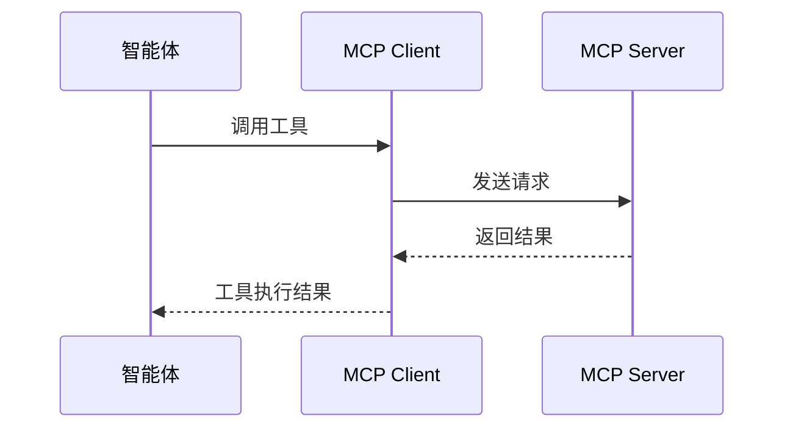

# AI 功能

本文档详细介绍 RuoYi-Langchain4j 平台的 AI 能力。

---

## 🤖 AI 模型管理

### 模型类型

平台支持两类 AI 模型：

**LLM 大语言模型**：
- 用于智能体对话、文本生成
- 支持 OpenAI、通义千问、Ollama 等兼容协议

**Embedding 向量模型**：
- 用于知识库文档向量化
- 支持本地模型（ModelScope 下载）和远程 API

### 模型配置

进入【AI 工具箱 → 模型管理】：

1. **添加 LLM 模型**
   - 模型名称：自定义标识
   - 模型类型：选择 `LLM`
   - 模型提供商：OpenAI / 通义千问 / Ollama 等
   - API Key：服务商提供的密钥
   - Base URL：API 地址
   - 模型名称：具体模型（如 gpt-4、qwen-turbo）

2. **添加 Embedding 模型**
   - 模型类型：选择 `EMBEDDING`
   - 向量维度：根据模型配置（如 768、1536）

---

## 📚 知识库管理

### 知识库功能

- **文档上传**：支持 PDF、Word、TXT、Markdown 等格式
- **自动分段**：智能文档分段，支持人工调整
- **向量化**：使用 Embedding 模型将文档转为向量
- **语义检索**：基于向量相似度进行语义搜索

### 创建知识库

1. 进入【AI 工具箱 → 知识库管理】
2. 点击"新建知识库"
3. 填写知识库名称和描述
4. 上传文档（支持批量上传）
5. 选择 Embedding 模型
6. 等待文档分段和向量化完成

### 知识库配置

**分段策略**：
- 按字符数分段（默认 500 字符）
- 重叠字符数（默认 50 字符）
- 支持自定义分段规则

**检索配置**：
- Top-K：返回最相关的 K 个文档片段
- 相似度阈值：过滤低相似度结果

---

## 🧠 智能体（Agent）

### 智能体类型

平台支持三种智能体形态：

#### 1. 原生 LangChain4j Agent

**特点**：
- 基于 LangChain4j 框架
- 支持工具调用（Java Tool、Python Sandbox、MCP）
- 支持知识库检索（RAG）
- 流式输出

**适用场景**：
- 需要复杂工具调用
- 需要本地 Java 业务逻辑集成
- 需要 Python 代码执行

#### 2. Dify 类型智能体

**特点**：
- 通过 Dify API 调用
- 支持 Dify 平台的 Chatflow / Workflow / Agent
- 本地会话映射管理

**适用场景**：
- 已使用 Dify 平台构建应用
- 需要可视化工作流编排

#### 3. Agent Flow（多智能体编排）

**特点**：
- 基于 AntV X6 可视化画布
- 多个智能体串联协作
- 支持 origin 和 agentic 两种执行模式
- 每个节点可独立配置

**执行模式**：
- **origin 模式**：Java 后端 LangChain4j 原生执行
- **agentic 模式**：Python agentic 服务 DeepAgents 执行

### 创建智能体

1. 进入【AI 工具箱 → 智能体管理】
2. 点击"新建智能体"
3. 配置基本信息：
   - 智能体名称
   - 选择 LLM 模型
   - 系统提示词（System Prompt）
4. 关联知识库（可选）
5. 配置工具（可选）
6. 配置 MCP 工具（可选）
7. 配置 Skills 技能（可选）

---

## 🛠️ 工具系统

### 工具类型

#### 1. 内置工具（builtin）

**Java Tool**：
- 基于 `@Tool` 注解
- 通过反射自动注册
- 直接调用本地 Java 业务逻辑

**示例**：
```java
@Tool("查询用户信息")
public String queryUserInfo(@P("用户ID") Long userId) {
    // 业务逻辑
    return userService.getUserInfo(userId);
}
```

#### 2. Sandbox 工具（sandbox）

**Python 工具**：
- 在 Python 沙箱中执行
- 支持自定义 Python 函数
- 自动参数映射

**示例**：
```python
def calculate_sum(a: int, b: int) -> int:
    return a + b
```

#### 3. MCP 工具

**Model Context Protocol**：
- 标准化协议
- 支持 sse / stdio / streamable-http 传输
- 连接外部 MCP Server

**配置步骤**：
1. 进入【AI 工具箱 → MCP 管理】
2. 添加 MCP Service（URL、传输方式、认证 Token）
3. 系统自动发现可用工具
4. 在智能体中绑定 MCP 工具

---

## 📜 Skills 技能体系

### 技能类型

**create 类型**：
- 系统创建
- 在界面中直接编辑技能内容

**import 类型**：
- 从 `skills/` 目录导入
- 支持 SKILL.md 格式

### 技能结构

```markdown
# 技能名称

## 描述
技能的功能描述

## 使用场景
何时激活此技能

## 工具
activate_skill - 激活技能

## 内容
技能的详细内容和指令
```

### 技能使用

1. 进入【AI 工具箱 → Skill 管理】
2. 创建或导入技能
3. 在智能体中绑定技能
4. 技能内容自动注入 System Prompt
5. LLM 根据场景自动激活技能

---

## 💬 AI 对话

### 对话功能

- **流式输出**：实时显示 AI 回复
- **深度思考**：显示 Chain-of-Thought 推理过程
- **历史会话**：保存对话历史，支持回溯
- **多模态**：支持图片、文档上传
- **工具调用可视化**：实时显示工具调用过程

### 对话模式

**普通对话**：
- 选择单个智能体
- 直接对话

**Agent Flow 对话**：
- 选择多智能体 Flow
- 按节点顺序执行
- 支持独立配置每个节点

---

## 🔍 RAG 检索增强生成

### RAG 流程


### RAG 配置

**检索策略**：
- Top-K：返回最相关的 K 个文档
- 相似度阈值：过滤低相似度结果
- 重排序：可选的重排序模型

**Prompt 构建**：
```
基于以下上下文信息回答用户问题：

上下文：
{context}

用户问题：{question}

请基于上述上下文信息回答，如果上下文中没有相关信息，请说明。
```

---

## 🌐 联网搜索

### Tavily 搜索集成

**功能**：
- 在 RAG 管道中集成网页搜索
- 实时获取最新信息
- 与知识库检索结果融合

**配置**：
1. 进入【AI 工具箱 → 智能体管理】
2. 编辑智能体
3. 启用"网页搜索"
4. 配置 Tavily API Key
5. 设置搜索结果数量

---

## 📄 文档解析

### doc-parser 服务

**支持格式**：
- PDF（含 OCR）
- Word（DOCX）
- Excel（XLSX）
- PowerPoint（PPTX）
- HTML
- CSV
- Markdown
- 代码文件

**功能**：
- 文档内容提取
- 表格识别
- 图片 OCR
- 图片描述生成

**使用流程**：
1. 前端上传文件
2. ruoyi-admin 调用 doc-parser API
3. 返回解析后的 Markdown 内容
4. 前端展示并生成 attachmentId
5. 对话时携带 attachmentId

---

## 🐍 Python 沙箱

### 沙箱功能

**代码执行**：
- 安全执行 Python 代码
- 容器隔离
- 资源限制

**文件操作**：
- 读写文件
- 上传下载

**包管理**：
- pip install
- pip list

### 沙箱配置

```yaml
ai:
  sandbox:
    base-url: http://localhost:8194
    api-key: sandbox-secret-key
    timeout: 30
```

---

## 🔌 MCP 协议

### MCP 传输方式

**SSE (Server-Sent Events)**：
- HTTP 长连接
- 适合 Web 环境

**stdio**：
- 标准输入输出
- 适合本地进程

**streamable-http**：
- HTTP 流式传输
- 适合高并发场景

### MCP 工具调用流程



---

## 📊 可观测性

### 工具调用记录

- `agent_tool_invoke`：工具调用结果
- 关联消息 ID
- 记录输入参数和输出结果

### 知识库召回记录

- `agent_kb_invoke`：知识库召回分段
- 记录检索的文档片段
- 相似度分数

### 前端可视化

- `TOOL_CALL`：工具开始调用
- `TOOL_CALLED`：工具调用完成
- `RETRIEVED`：知识库召回

---

## 🎯 最佳实践

### 智能体设计

1. **明确职责**：每个智能体专注特定任务
2. **合理配置工具**：避免工具过多导致选择困难
3. **优化 System Prompt**：清晰描述智能体角色和能力
4. **测试迭代**：持续测试和优化

### 知识库优化

1. **文档质量**：确保文档内容准确
2. **合理分段**：根据文档类型调整分段策略
3. **定期更新**：保持知识库内容最新
4. **测试检索**：验证检索效果

### 性能优化

1. **模型选择**：根据场景选择合适的模型
2. **缓存策略**：利用 Redis 缓存对话记忆
3. **异步处理**：文档解析、向量化异步执行
4. **批量操作**：批量上传和向量化
