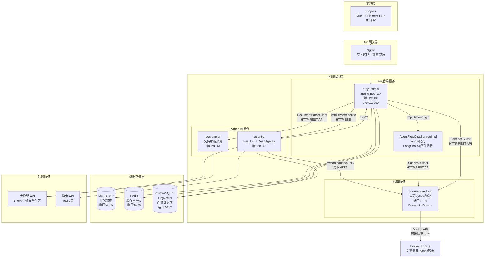
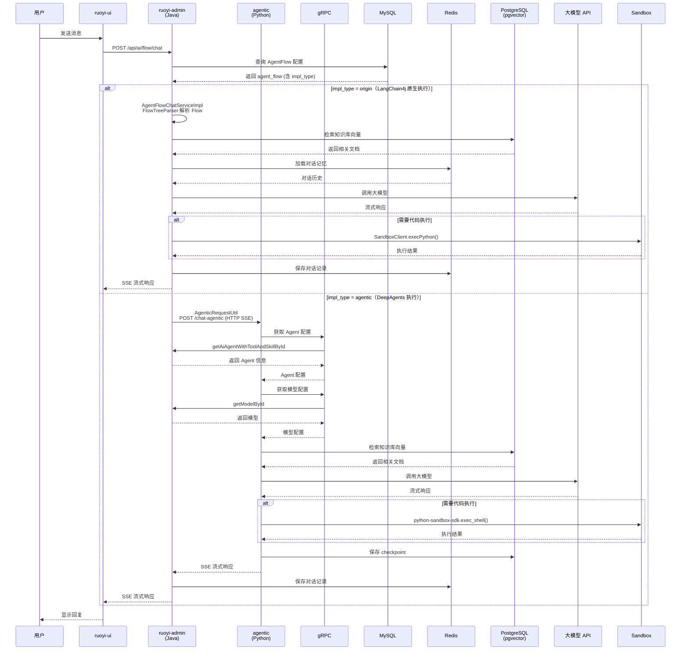
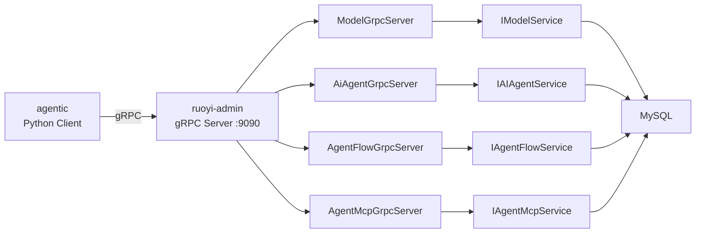
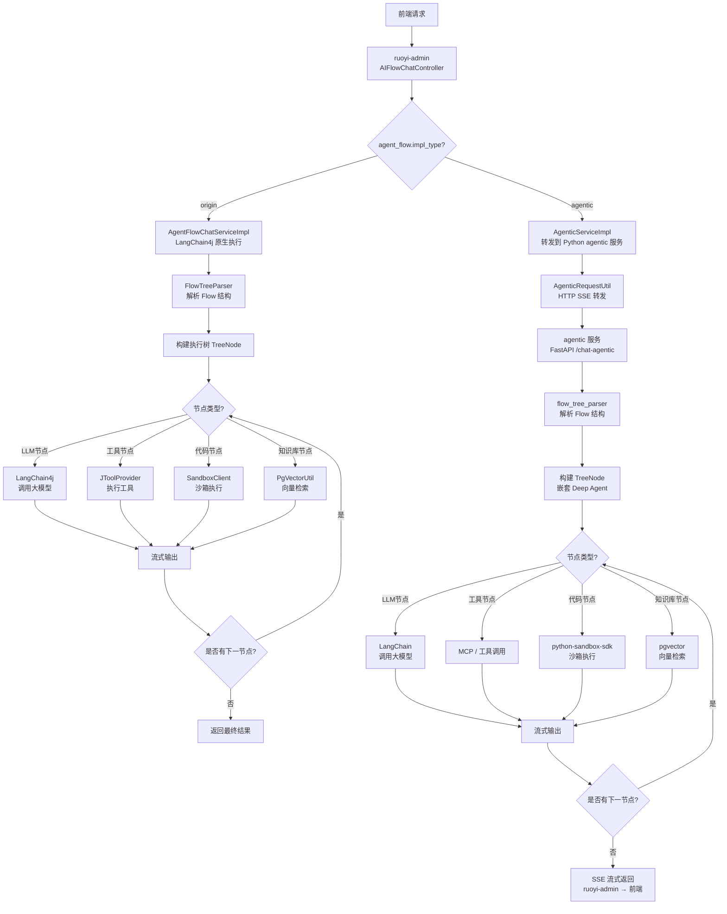

# 架构设计

本文档详细介绍 RuoYi-Langchain4j 的系统架构、服务组件和调用链路。

---

## 🏗️ 整体架构

---

## 📦 服务组件

### ruoyi-admin (Java 后端服务)

**技术栈**：
- Spring Boot 2.x
- MyBatis + Druid 连接池
- LangChain4j (AI 能力集成)
- gRPC Server (端口 9090)

**核心职责**：
- 用户认证与权限管理
- AI Agent 配置管理
- 模型管理
- 知识库管理
- 工具管理
- MCP 服务管理
- 对话记录存储
- 提供 gRPC 服务供 Python 服务调用
- 文档解析服务调用（通过 DocumentParseClient）

**gRPC 服务接口**：
- `ModelGrpcServer`: 模型信息查询
- `AiAgentGrpcServer`: AI Agent 信息查询
- `AgentFlowGrpcServer`: Agent Flow 配置查询
- `AgentMcpGrpcServer`: MCP 服务配置查询

### agentic (Python AI Agent 服务)

**技术栈**：
- FastAPI
- LangChain / DeepAgents
- gRPC Client
- SQLAlchemy (异步)

**核心职责**：
- Agent Flow 执行引擎（agentic 模式）
- 多 Agent 协作编排
- 工具调用管理
- 联网搜索集成
- 代码执行沙箱集成
- 流式响应输出 (SSE)

**核心 API**：
- `POST /chat-agentic`: Agent 对话接口 (流式响应)
- `GET /health`: 健康检查

### doc-parser (文档解析服务)

**技术栈**：
- FastAPI
- Docling (文档解析)
- OCR 模型集成

**核心职责**：
- PDF/Word/Excel 文档解析
- 图片 OCR 识别
- 文档内容结构化
- 向量化预处理

**调用方式**：
- 由 ruoyi-admin 通过 HTTP REST API 调用
- 前端上传文件 → ruoyi-admin 调用 doc-parser → 返回解析内容 → 前端携带 attachmentId 发起对话

### agentic-sandbox (自研 Python 代码执行沙箱)

**技术栈**：
- Docker-in-Docker (DinD)
- Python 3.12
- 自研 HTTP REST API 服务

**核心职责**：
- 安全执行用户提交的 Python 代码和 Shell 命令
- 资源限制 (CPU/内存)
- 会话管理 (Session)
- 容器生命周期管理

**双路径调用**：
- **ruoyi-admin (Java)**: 通过 `SandboxClient.java` 调用（origin 模式）
- **agentic (Python)**: 通过 `python-sandbox-sdk` 调用（agentic 模式）

---

## 🔗 调用链路

### Agent Flow 对话主链路（双模式路由）

Agent Flow 对话请求统一由前端发送到 `ruoyi-admin`，后端根据 `agent_flow.impl_type` 字段决定执行路径：

- **origin 模式**：`ruoyi-admin` 自身使用 LangChain4j 原生执行 Flow
- **agentic 模式**：`ruoyi-admin` 通过 `AgenticServiceImpl` → `AgenticRequestUtil` 将请求转发给 Python `agentic` 服务

### gRPC 调用链路

### Agent Flow 执行链路（双模式对比）

---

## 🗄️ 中间件架构

### MySQL 8.0

**用途**：
- 业务数据持久化存储
- 用户、角色、权限数据
- AI Agent 配置数据
- 对话记录存储

**关键表**：
- `sys_user`, `sys_role`, `sys_menu`: 系统权限
- `ai_agent`: AI Agent 配置
- `ai_model`: 模型配置
- `ai_agent_flow`: Agent Flow 定义
- `ai_tool`, `ai_mcp_service`: 工具与 MCP 服务
- `chat_message`, `chat_flow_message`: 对话记录
- `knowledge_base`: 知识库配置

### Redis

**用途**：
- 会话缓存
- 验证码存储
- 对话记忆 (Chat Memory)
- 令牌管理
- 在线用户管理

### PostgreSQL 15 + pgvector

**用途**：
- 向量数据库
- 知识库 Embedding 存储
- 语义检索

**关键特性**：
- pgvector 扩展: 向量相似度计算
- pgvectorscale: 高性能向量检索
- 向量维度: 768 (text2vec-base-chinese)

---

## 🔐 安全机制

### 认证授权
- JWT Token
- 验证码 (滑块/文字点选)
- XSS 防护
- SQL 注入防护 (Druid Wall)

### 沙箱安全
- 容器隔离
- 资源限制
- 超时控制
- API Key 认证

---

## 📊 性能优化

### 数据库优化
- 连接池配置 (Druid)
- 向量索引: pgvector HNSW
- 业务索引优化

### 缓存策略
- Caffeine 本地缓存 (热点数据)
- Redis 分布式缓存 (会话、对话记忆)

### 异步处理
- FastAPI 异步
- Spring @Async
- 消息队列 (规划中)
